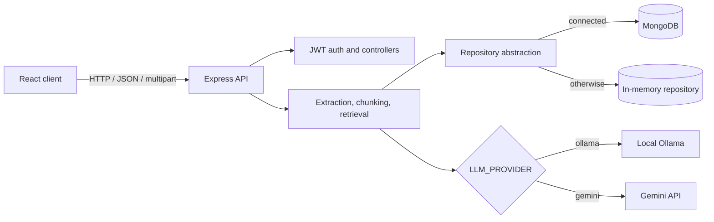

# NeuroFlow AI

NeuroFlow AI is a workspace-based document intelligence app. Upload files, search their extracted text, ask questions with source citations, and run structured document workflows. The backend uses MongoDB when configured and an in-memory repository otherwise.

## Features

- Register, sign in, and manage user-scoped workspaces.
- Upload PDF, DOCX, TXT, Markdown, CSV, PNG, JPG, JPEG, and WEBP documents (10 MB limit).
- Extract text, split documents into overlapping chunks, and retrieve passages by embeddings or keyword overlap.
- Ask questions over a workspace and view citations, workflow history, evaluation notes, and execution traces.
- Run summarize, compare, meeting action item, and research brief workflows.
- Use Ollama locally by default, optionally switch to the Gemini API, or fall back to deterministic workflow logic when AI services are unavailable.
- Use MongoDB/Mongoose storage or an in-memory repository when MongoDB is unavailable.
- Deploy the Vite single-page client on Vercel or Netlify with the included client-side route rewrites.

## Tech stack

- **Client:** React 18, Vite 6, Tailwind CSS 3, React Router 6, TanStack React Query 5, Zustand 5, Axios, lucide-react. `react-hook-form` is included as a dependency; the current screens use native form elements.
- **Server:** Node.js, Express 4, Mongoose 8, bcryptjs, jsonwebtoken, multer, morgan, dotenv.
- **Document processing:** pdf-parse, mammoth, csv-parse, tesseract.js. `sharp` is present in the server dependencies but is not currently used by the ingestion path.
- **AI:** Ollama HTTP API (default models: `llama3.1:8b` and `nomic-embed-text`) or the optional Gemini API (default models: `gemini-3.8-flash` and `gemini-embedding-2`).

## Architecture

The React client sends authenticated API requests to Express. Express handles authentication, uploads, document processing, retrieval, and workflows. The shared repository writes to MongoDB when connected and otherwise uses in-memory storage. AI requests go to the configured local Ollama service or the optional hosted Gemini API; deterministic fallbacks keep core workflows available when a provider is unavailable.



## Local setup

### Prerequisites

- Node.js 20 or newer and npm.
- MongoDB Atlas or a local MongoDB instance (optional; memory mode is used if `MONGODB_URI` is empty or MongoDB cannot connect).
- Ollama for local model inference. Pull the default models:

  ```sh
  ollama pull llama3.1:8b
  ollama pull nomic-embed-text
  ```

### Install and configure

1. Clone this repository and open a terminal at the project root.
2. Copy the environment examples:

   ```sh
   cp server/.env.example server/.env
   cp client/.env.example client/.env
   ```

   In PowerShell, use `Copy-Item server/.env.example server/.env` and `Copy-Item client/.env.example client/.env` instead. Replace the placeholder values in `server/.env`; use a long random `JWT_SECRET`. Leave `MONGODB_URI` empty to use memory mode. The server loads `server/.env`; Vite loads `client/.env`. Keep both `.env` files private and uncommitted.

3. Install server and client dependencies in separate terminals:

   ```sh
   cd server
   npm install
   npm run dev
   ```

   ```sh
   cd client
   npm install
   npm run dev
   ```

4. Open `http://localhost:5173`. The API listens on `http://localhost:3001`.

To use Gemini instead of Ollama, set `LLM_PROVIDER=gemini` and provide `GEMINI_API_KEY` in `server/.env`. The server reads that key only; it is never sent to the browser. Set `GEMINI_CHAT_MODEL` and `GEMINI_EMBED_MODEL` if you want different models. Gemini API quotas and charges depend on your Google AI plan.

## API overview

All routes are mounted under `/api`. Except for health and auth register/login, routes require a bearer token.

| Method | Route | Purpose |
|---|---|---|
| GET | `/api/health` | Health and repository mode |
| POST | `/api/auth/register` | Register |
| POST | `/api/auth/login` | Sign in |
| GET | `/api/auth/me` | Current account |
| GET, POST | `/api/workspaces` | List or create workspaces |
| GET, PATCH, DELETE | `/api/workspaces/:id` | Read, update, or delete a workspace |
| GET | `/api/dashboard` | Dashboard counts and recent runs |
| GET | `/api/workspaces/:workspaceId/documents` | List workspace documents |
| POST | `/api/workspaces/:workspaceId/documents/upload` | Upload and process a document (`file` multipart field) |
| GET | `/api/documents/:id` | Read a document |
| POST | `/api/documents/:id/reprocess` | Reprocess a document |
| DELETE | `/api/documents/:id` | Delete a document |
| GET, POST | `/api/workspaces/:workspaceId/chat` | List chat threads or ask a question |
| GET | `/api/workspaces/:workspaceId/chat/:threadId/messages` | Read thread messages |
| GET | `/api/workspaces/:workspaceId/runs` | List workflow runs |
| GET | `/api/runs/:id` | Read a workflow run |
| POST | `/api/workspaces/:workspaceId/runs/summarize` | Summarize workspace documents |
| POST | `/api/workspaces/:workspaceId/runs/compare` | Compare selected documents (two or more ready documents) |
| POST | `/api/workspaces/:workspaceId/runs/meeting-action-items` | Extract meeting action items |
| POST | `/api/workspaces/:workspaceId/runs/research-brief` | Create a research brief |

## Limitations and next steps

- The evaluator currently records a heuristic confidence and note; the repository does not include a benchmark or evaluation dataset.
- The Gemini provider is optional and uses a hosted API. Ollama is local-only and is not reachable from a hosted backend unless you provide a reachable Ollama service.
- Uploaded files are stored on the server filesystem under `server/uploads`. A hosted deployment needs persistent storage or uploads may be lost when the service restarts or redeploys.
- In-memory repository data is lost when the server process stops.
- Switching embedding providers does not automatically re-embed existing chunks. Reprocess documents after changing providers to get consistent vector retrieval; keyword retrieval remains available in the meantime.
- OCR quality depends on the image and Tesseract language data available to the server.
- Demo sample data is seeded only when `SEED_SAMPLE_DATA=true` and `DEMO_USER_PASSWORD` is configured.

## Live demo

Live demo: (coming soon)
